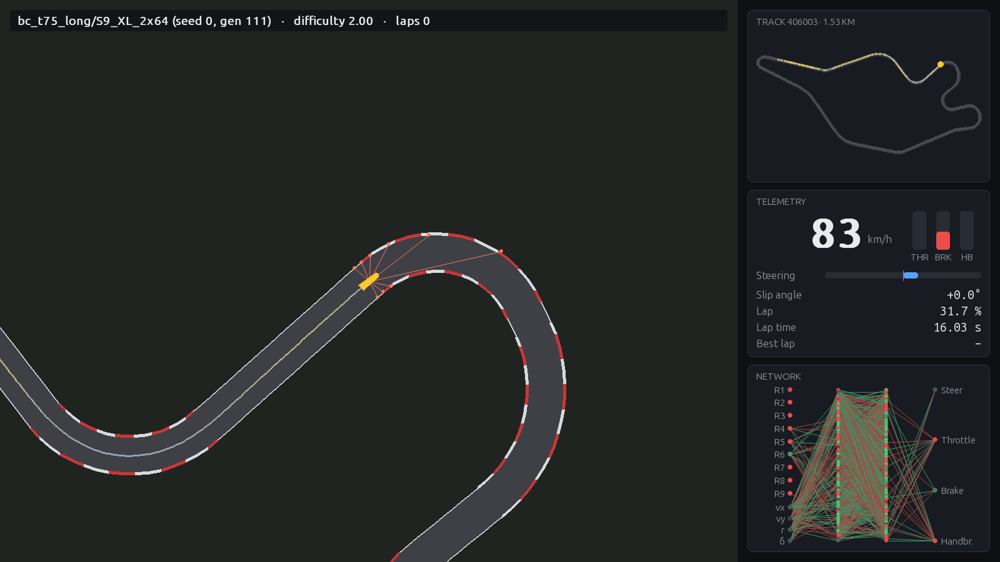

# 2D Map Self-Driving Car Neural Network

โครงงานรายวิชา Linear Algebra: รถแข่งสองมิติที่ขับด้วยโครงข่ายประสาทเทียม (neural network) บนสนามแบบ F1 ที่สร้างใหม่แบบสุ่ม
รถรับรู้สนามผ่านเซนเซอร์วัดระยะเท่านั้น ระบบทั้งหมด ได้แก่ ฟิสิกส์ เซนเซอร์ neural network การฝึก และการบีบอัด
เขียนด้วย NumPy โดยไม่ใช้ไลบรารี deep learning สำเร็จรูป ทุกขั้นตอนอาศัยทฤษฎีเวกเตอร์และเมทริกซ์

*A 2D racing car driven by a small neural network on procedurally generated F1-style circuits. Physics, ray sensors,
networks, genetic algorithm, behavior cloning (hand-written backprop + Adam) and model compression are all plain NumPy.*



## ผลลัพธ์หลัก

ฝึก 4 ขนาด (XS Linear 56 พารามิเตอร์ ถึง XL 2×64 5,316 พารามิเตอร์) × 4 seed ตามหลักสูตร 7 สถานี แล้วสอบบน 210 สนามที่ไม่เคยเห็น

| วิธีฝึก | XS | S | L | XL |
|---|---|---|---|---|
| Genetic Algorithm (รถเรียนเอง) | 70 % | **81 %** | 65 % | 60 % |
| เรียนจากครูด้วย gradient (ครูใช้ยาง 75 %) | 16 % | 82 % | 88 % | **94 %** |

- **ขนาดโมเดลที่เหมาะขึ้นกับวิธีฝึก:** GA ดีที่สุดกับโมเดลเล็ก ส่วน gradient ได้ประโยชน์จากโมเดลใหญ่เมื่องานยากพอ
- **PCA:** เซนเซอร์ 17 รังสีที่บีบเหลือ 4 มิติด้วยเวกเตอร์ไอเกน (93 %) ดีกว่าใช้รังสีจริง 9 เส้น (88 %) และดีกว่าการฉายแบบสุ่ม 4 มิติ (50 %)
- **การบีบอัด:** ลดเหลือ 8 bit แทบไม่เสียความสามารถ ส่วนการตัดโหนดและ low-rank SVD ทำให้ระบบขับแบบวงปิดพัง

รายละเอียด ตัวเลข และกราฟทั้งหมดอยู่ใน [`docs/RESULTS_LOG.md`](docs/RESULTS_LOG.md) และ [`figures/`](figures)

## ติดตั้งและใช้งาน

```bash
python -m venv .venv && source .venv/bin/activate      # Windows: .venv\Scripts\activate
pip install -r requirements.txt

python -m app.demo          # โปรแกรมสาธิต: เลือกสนาม (สุ่ม / seed / วาดเอง) ความยาก 0–3 และโมเดล
python -m app.viewer --run experiments/results/bc_t75_long/S9_XL_2x64/seed1 \
       --snapshot station_2.00.npz --difficulty 2.0              # ดูโมเดลขับ (1/2/3 ซูม, N สนามใหม่, P ถ่ายภาพ)
```

ผลการทดสอบในโปรแกรมสาธิตบันทึกที่ `data/demo_results.csv` และสรุปด้วย `python analysis/demo_summary.py`

ฝึกและทดลองซ้ำ:

```bash
python -m racing.train --name test --rays 9 --depth 2 --width 8 --seed 0 --saturate \
       --stations 0.5,0.75,1.0,1.25,1.5,1.75,2.0              # GA, 7 สถานี
python -m racing.bc --name test_bc --depth 2 --width 64 --seed 0 --aggregate all \
       --teacher-grip 0.75 --teacher-brake 0.62 --steps 3000 --patience 8   # behavior cloning + DAgger
python experiments/run_stage.py stage3 --rays 9 --jobs 12 --seeds 0,1,2,3    # การทดลองขนาดโมเดล (GA)
python experiments/compress_stage4.py --source bc_t75_long --out stage4_bc   # การบีบอัด
python tools/build_dataset.py      # ชุดข้อมูลการขับ สถิติ การทำความสะอาด PCA
python tools/physics_check.py      # ชุดทดสอบฟิสิกส์ 12 รายการ
```

## โครงสร้าง

| โฟลเดอร์ / ไฟล์ | หน้าที่ |
|---|---|
| `racing/track.py` | ตัวสร้างสนาม: convex hull, ท่าโค้ง F1, เส้นโค้ง Bezier, ความโค้งจากผลคูณไขว้ |
| `racing/physics.py` | dynamic bicycle model, ยาง Pacejka, เซนเซอร์ (ระบบสมการ 2×2 + กฎของคราเมอร์), การชน |
| `racing/reference.py` | ตัวควบคุมอ้างอิง (ครู): pure pursuit + โปรไฟล์ความเร็ว |
| `racing/inputs.py` | เวกเตอร์อินพุต, PCA (ค่าไอเกนของเมทริกซ์ความแปรปรวนร่วม), random projection (QR) |
| `racing/network.py`, `racing/ga.py` | neural network ทั้งประชากรเป็นเทนเซอร์, Genetic Algorithm |
| `racing/bc.py` | behavior cloning + DAgger, backpropagation และ Adam ด้วย NumPy |
| `racing/train.py`, `racing/showcase.py` | หลักสูตร 7 สถานี การสอบ และโมเดลตัวโชว์ |
| `racing/compress.py` | ตัดโหนด (least squares / normal equations), quantization, SVD |
| `experiments/`, `analysis/` | สคริปต์การทดลองและกราฟ; ผลดิบใน `experiments/results/` |
| `notebooks/linear_algebra_calculations.ipynb` | ไฟล์แสดงการคำนวณทฤษฎีเวกเตอร์และเมทริกซ์ |
| `report/` | สคริปต์สร้างรายงาน (`node report/build_report.js`) |
| `docs/` | แผนการทดลอง, บันทึกผล, บันทึกปัญหา, เนื้อหาการนำเสนอ |

## พีชคณิตเชิงเส้นในโครงงาน

| ทฤษฎี | ใช้ที่ |
|---|---|
| การบวกเวกเตอร์, การหมุน R(ψ) | การเคลื่อนที่ของรถ |
| ผลคูณจุด, การฉาย | ระยะทางบนสนาม, ระยะห่างจากเส้นกลาง, การตรวจการชน |
| ผลคูณไขว้ 2 มิติ | รัศมีความโค้งของถนน |
| ระบบสมการเชิงเส้น, ดีเทอร์มิแนนต์, กฎของคราเมอร์ | จุดตัดของรังสีเซนเซอร์กับขอบถนน |
| การคูณเมทริกซ์ (แบบกลุ่ม) | neural network ทั้งประชากรในครั้งเดียว |
| ค่าไอเกน, เมทริกซ์ตั้งฉาก | PCA ลดมิติเซนเซอร์, การหมุนแกน |
| ทรานสโพส, ผลคูณภายนอก | backpropagation |
| กำลังสองน้อยสุด, สมการปกติ | การตัดโหนด |
| SVD, แรงก์ | low-rank compression, แรงก์ประสิทธิผล |
| ปริภูมิเวกเตอร์ของน้ำหนัก | การกลายพันธุ์ของ Genetic Algorithm |

`legacy_v1/` เก็บโค้ดรุ่นแรกของโครงงาน (ฟิสิกส์แบบจุดมวล) ไว้อ้างอิง
